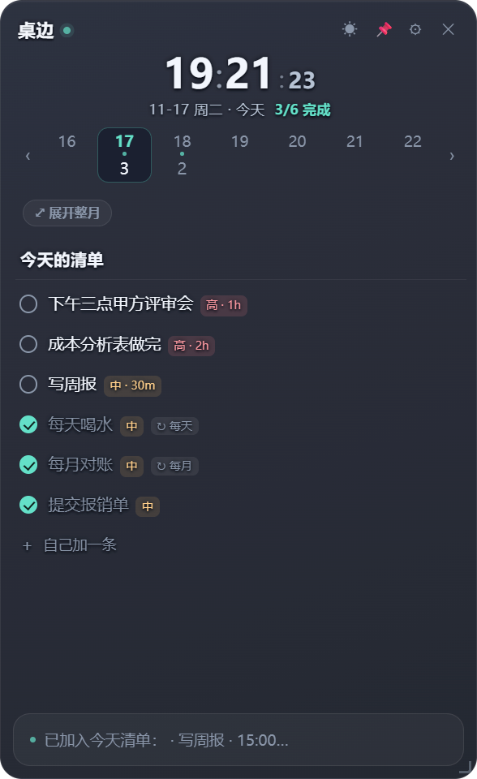
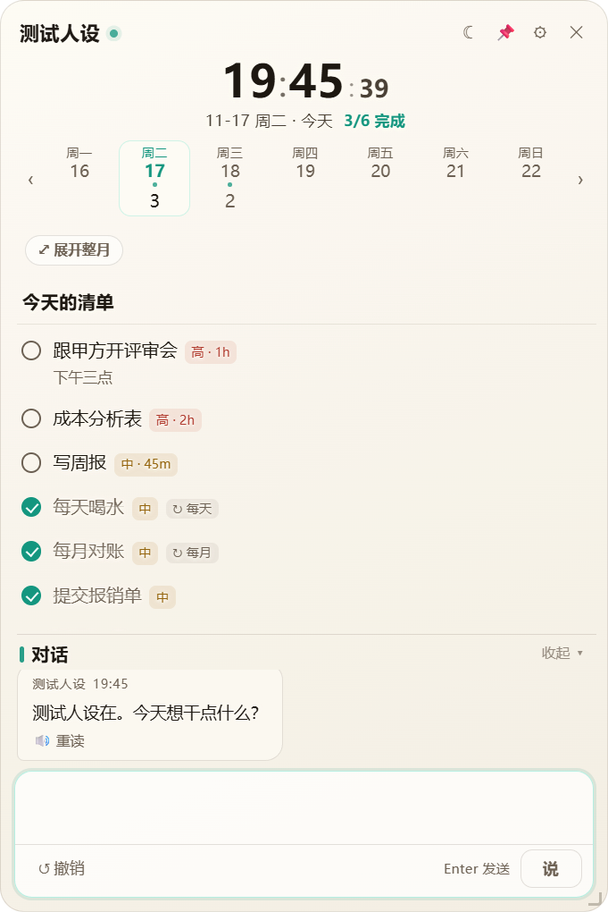
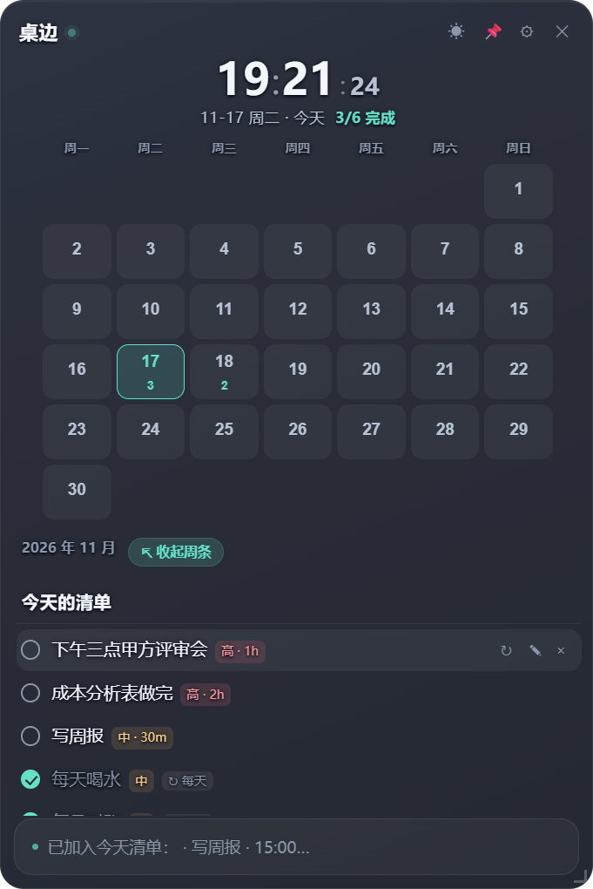
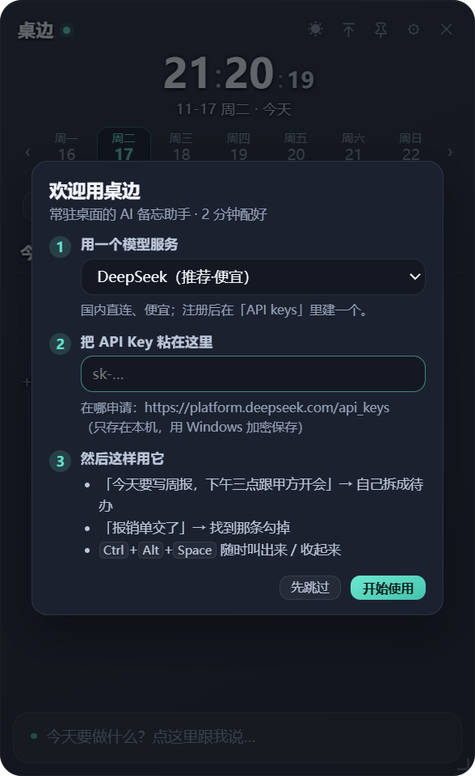
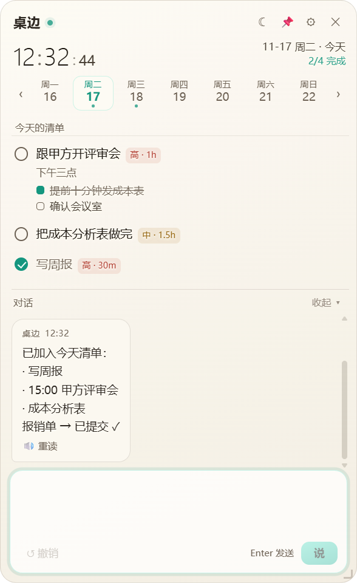
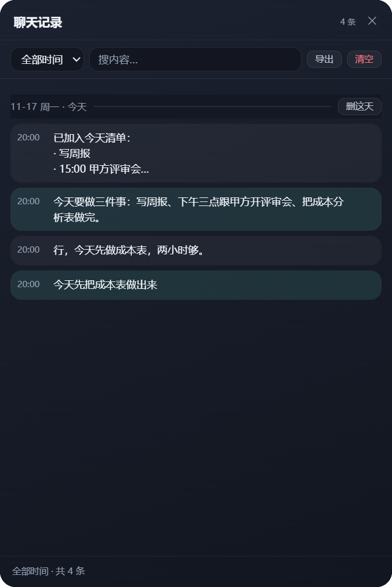

# 桌边 · Deskside

> 常驻桌面的 AI 备忘助手：上面是今天的待办，下面是能说话的输入框。说一句话它就帮你记、帮你勾、还会念给你听。

一个 Electron 桌面小窗，贴在你桌角。不做全能记事本，只解决「今天要干什么、干到哪了」这件事。



---

## 它能做什么

- **说一句就成待办**：「今天要写周报，下午三点跟甲方开会，成本分析表得做完」→ 自动拆成 3 条，带优先级、预计耗时、子步骤
- **说一声就勾掉**：「报销单交了」→ 找到那条勾掉；清单里没有就记一条「已完成」，不会留成没干的活
- **含糊的话先反问**：「那个表还得再弄一下」→ 它先问「指的是哪件事」，给你选项，不瞎改
- **跨天顺延**：没干完的自动跟到明天；点周条上任意一天，能看那天的清单、给那天加一条
- **周期待办**：每天 / 每周 / 每月，勾完自动长出下一次（喝水、周报、月度对账都行）
- **提醒**：不占清单的小闹钟（每 N 分钟 / 每天几点），到点用你设定的口吻说一句
- **日常关怀**：隔一阵主动说句话——喝水、起来走走、眼睛歇会儿，可开关、可设静默时段
- **会说话**：微软在线音色开箱可用；还能克隆任意角色音色（本地跑 IndexTTS-2.5，参考音频 5~30 秒）
- **人设**：多个助手人设，各自性格、音色、聊天记录互不干扰；待办是共用的
- **白天 / 夜间自动换肤**，界面透明度、窗口固定、拖拽改大小

### 再几张图

| 白天（冷调灰白） | 整月日历 | 首次向导 |
| --- | --- | --- |
|  |  |  |

| 对话展开 | 聊天记录管理 |
| --- | --- |
|  |  |

## 快速开始（Windows）

1. 到 [Releases](https://github.com/<你的账号>/deskside/releases) 下载 `桌边-win32-x64.zip`，解压到任意目录（免安装）
2. 双击 `桌边.exe`
3. 第一次打开会弹一个向导：选模型服务 → 粘 API Key → 开始用

没有 Key 也能先记待办，只是不能用 AI 功能。

## 它支持哪些模型

设置 → 模型 → 接口风格，三种风格覆盖绝大多数服务：

| 想用 | 接口风格 | 地址填 | 模型填 |
| --- | --- | --- | --- |
| DeepSeek（推荐，便宜） | OpenAI 兼容 | `https://api.deepseek.com` | `deepseek-chat` / `deepseek-reasoner` |
| 硅基流动 | OpenAI 兼容 | `https://api.siliconflow.cn/v1` | `deepseek-ai/DeepSeek-V3` |
| OpenAI | OpenAI 兼容 | `https://api.openai.com/v1` | `gpt-4o-mini` |
| Claude | Anthropic | `https://api.anthropic.com` | `claude-sonnet-4-5` |
| 本机 Ollama | Ollama | `http://127.0.0.1:11434` | `qwen2.5:7b` |
| LM Studio | OpenAI 兼容 | `http://127.0.0.1:1234/v1` | 你载入的模型名 |

地址会自动补 `/chat/completions`、`/v1/messages`、`/api/chat`，填域名或带 `/v1` 都行；本地服务不需要 Key。某些模型不支持 `response_format`，会被自动识别并重试一次。

## 快捷键

| 按键 | 作用 |
| --- | --- |
| `Ctrl+Alt+Space` | 叫出来 / 收起来 |
| `Enter` | 发送 |
| `Esc` | 收起对话 / 关闭面板 |
| 标题栏 📌 | 贴桌面 ⇄ 浮在最前 |
| 标题栏图钉 | 固定窗口位置与大小 |

## 数据与隐私

- 所有数据都在本机 `%APPDATA%\桌边\`：`store.json`（待办、人设、聊天记录）、`voices\`（参考音频）、`tts\`（语音缓存）
- **API Key 用 Windows DPAPI 加密**后写入，只在本机可解；不会上传到任何地方
- 除了你配置的模型服务（以及在线语音用到的微软接口），没有别的网络请求；没有遥测、没有自动更新、没有账号
- 聊天记录默认保留 1 个月，可设 3 天 ~ 无限；上下文读取窗口也能单独设，还能选「精简模式」省 token

## 自己编译

需要 Node 20+、pnpm。

```bash
git clone https://github.com/<你的账号>/deskside.git
cd deskside
pnpm install
pnpm start          # 开发运行
pnpm build          # 打包成 dist/桌边-win32-x64/
```

`build.sh` 会先做一份 hoisted 的生产依赖（pnpm 的软链结构打进 asar 会找不到模块），再调 `electron-packager`。国内网络可加 `ELECTRON_MIRROR=https://npmmirror.com/mirrors/electron/`。

## 本地音色克隆（可选，需要显卡）

默认用微软在线音色，不装任何东西也能用。想让助手用某个角色的声音，可以本地跑 IndexTTS-2.5：

```bash
# 1) 装环境 + 下模型（约 20 GB，需要 NVIDIA 显卡，8 GB 显存够用）
bash tts-install.sh                          # 默认装到 ~/index-tts
# 2) 把 tts-server.py 放进该目录，启动本地服务
python tts-server.py --repo ~/index-tts --model-dir ~/index-tts/checkpoints --port 8756
```

然后在 设置 → 声音 里「+ 添加音色」，引擎选「本地」，挑一段 5~30 秒干净人声。桌边会在你需要时自动拉起这个服务（也可在设置里手动启停，释放显存）。

> ⚠️ **模型许可**：IndexTTS-2.5 采用 bilibili 模型使用协议，**不随本项目分发**，请自行下载并遵守其条款；用它克隆真人/角色声音请留意肖像与声音权，自用可以，公开发布作品前请自行确认授权。

## 已知限制

- 只做了 Windows（依赖 `WS_EX_TOOLWINDOW` 不进任务栏、DPAPI 加密、注册表开机自启）
- 在线语音走微软 Edge 的朗读接口，非官方授权通道，未来可能失效；失效时自动退回离线朗读
- 本地音色首次加载需要 30~60 秒（要载模型），之后一句 3~7 秒；同时跑游戏可能显存不够

## 目录结构

```
main.js            主进程：窗口、存储、待办、定时器、IPC
tts.js             语音引擎路由：微软 / 本地 IndexTTS / Fish Audio
tts-server.py      本地 IndexTTS HTTP 服务（/health、/tts）
tts-install.sh     本地语音环境安装脚本
preload.js         contextBridge 白名单
renderer/          index.html + style.css + app.js（无框架）
tools/             模型多线程下载器、参考音频抽段脚本
assets/            图标
使用说明.md        面向普通用户的手册
```

## 许可

[MIT](LICENSE)。第三方组件许可见 [NOTICE](NOTICE)。
